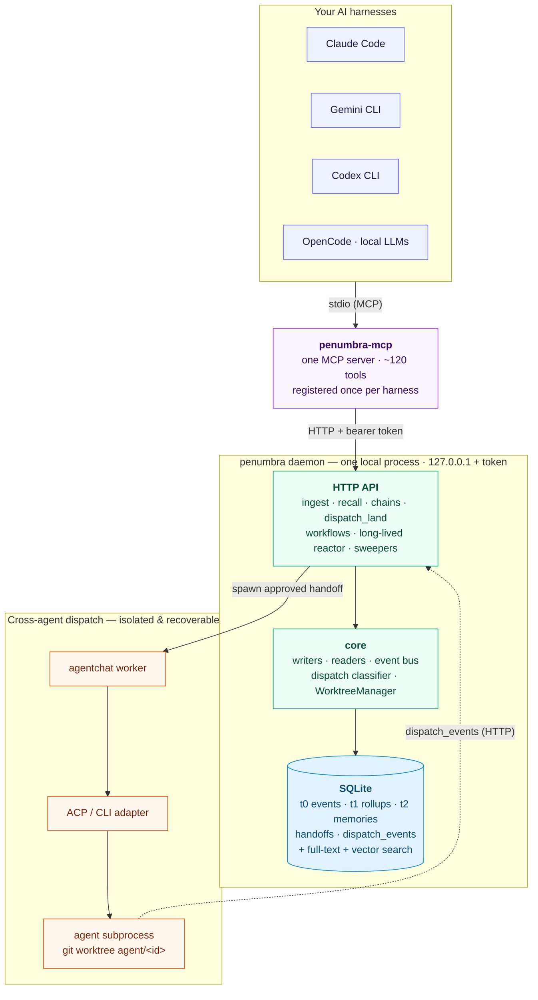

# penumbra

[](./LICENSE)
[](https://bun.sh)
[](./tsconfig.base.json)


**Local-first memory, dispatch, and workflow runtime for AI coding agents.**

_One MCP server gives Claude Code, Gemini CLI, Codex, OpenCode, and local LLMs a shared memory, a way to hand work to each other, and workflows that run on a schedule — all on your machine, in one SQLite file._

Penumbra is the layer between you and your AI agents. It remembers what they do, lets them call each other, runs them as workflows, schedules them on a cron, and gives every session searchable context from every prior session.

If you use Claude Code, Gemini CLI, Codex, OpenCode, or local LLMs — possibly more than one — penumbra makes them act like a coherent system instead of disconnected sessions.

> **Dogfooded.** Penumbra is developed using its own memory, dispatch, and workflow runtime — the same machinery described below coordinates the day-to-day work on it. It's built for AI-agent workflows, and exercised against one daily.

## How it fits together

One daemon, one SQLite database, one MCP server per harness. Your agents talk to penumbra; penumbra coordinates them — and every dispatch runs in its own git worktree, so parallel work never collides and every run is recoverable.



For the full component breakdown and data flow, see [`docs/architecture.md`](./docs/architecture.md).

---

## The problem

Every AI coding session starts cold. You explain the codebase, the constraints, the conventions, the past decisions. You're the human cache between your agents. When the session ends, all of it evaporates.

Worse, your agents can't reach each other. Want Claude to plan, Gemini to execute, Codex to review? You become the messenger, copy-pasting between tabs. Want to run an agent overnight on a cron job? You don't — there's nowhere for it to live.

Penumbra fixes both.

---

## What it does

### Memory that survives the session

Every LLM call, tool use, and outcome gets written to a local SQLite database. Three tiers:

- **t0** — raw events. Every prompt, every tool call, every cost figure.
- **t1** — session rollups. Each session's events are condensed into one searchable summary — totals, tool-call summary, first prompt and last response.
- **t2** — long-term observations. Architectural decisions, hard-won fixes, bug patterns — promoted from t1 by an LLM judge that keeps only what takes judgment to rediscover (not what a `grep` or `git log` would surface).

Recall is semantic (vector + FTS) and scoped (by project, file, time, or topic). Open a new session three weeks later, ask `mcp__penumbra__memory_recall` "what did we decide about the auth refactor?" and get the actual answer with citations to the original commits and conversations.

### Cross-agent dispatch with a paper trail

Penumbra brokers handoffs between any agents you've registered — Claude, Gemini, Codex, OpenCode, local Qwen, your own. Two interfaces:

- **MCP tool from your harness** — `mcp__penumbra__chain_start initial_agent=claude-acp-sonnet message="..."`. Whichever agentic harness you're in (Claude Code, Gemini CLI, Codex CLI) can dispatch to any other agent without you touching a keyboard.
- **Operator CLI** — `penumbra workflow run`, `penumbra plan start`, `penumbra task next` for shell-driven flows.

Every dispatch goes through an approval gate (or `trust_mode: 'all'` for hands-free). Outcomes get ranked into `agent_recommend` so you stop guessing which agent suits which task type. Every chain has a recoverable worktree, a branch, and an audit trail.

### Workflows that read your memory

Author a workflow once in markdown or TypeScript:

```yaml
# plugin/playbooks/post-mortem/playbook.md frontmatter
triggers:
  - kind: slash
    command: post-mortem
recall:
  - source: memory.search
    args: { query: "{{args.topic}} bugfix", limit: 8 }
output:
  - kind: file
    path: docs/post-mortems/{{date}}-{{args.topic}}.md
```

Penumbra recalls relevant memory before the run, dispatches the right agents in parallel, captures the outcomes back into memory, and tracks per-workflow success rates. A workflow that fails three runs in a row auto-quarantines.

Shipped workflows include `adversarial-review` (fans a diff across a configurable panel of reviewer personas with distinct biases and synthesizes the findings) and `adversarial-plan` (the planning analogue).

### Long-lived agents on cron

Schedule an agent to tick every 10 minutes. It carries persistent working memory across ticks, has its own MCP allowlist + approval gate, and gets auto-recovered when something breaks (circuit breaker + `long_lived.resume`).

Built-ins:

- `home-mgmt` — Home Assistant monitor. Pulses entity state, flags anomalies, requests config changes via the approval gate.
- `task-refiner-primary` + `task-refiner-escalation` — promote pending task drafts into the work queue.

Register your own in `~/.config/penumbra/agents.yaml` (with its `long_lived_config` block); per-thread `working_memory.notes` are server-side tail-truncated so the agent never runs out of context.

### Dispatch reliability you can trust

Every dispatch's lifecycle is traced as events (`acp.session.start`, `agent.thought`, `agent.heartbeat`, `agent.tool_call.failed`, `acp.session.end`). The classifier knows the difference between "actively thinking" and "wedged":

- The `stale-handoff-sweeper` won't force-kill a session that's emitting events.
- The `worktree-gc` sweeper auto-removes orphaned worktrees every 30 minutes.
- The `reconciler-sweep` closes orphaned GitHub PRs whose handoff terminated.
- The MCP `dispatch.land` flow tears down branch + worktree on a clean merge so backlog doesn't accumulate.

Per-task-class TTLs mean a long diagnostic dispatch (45 min) doesn't get killed at the same threshold as a smoke test (10 min).

### One MCP server, every harness

Register `penumbra-mcp` once in your harness config. Every harness then has the same memory, dispatch, workflow, agent-routing, lane, long-lived, worktree, and task surface — your agents talk to penumbra, not to each other through copy-paste.

---

## Install

Standard install:

```bash
git clone https://github.com/frozename/penumbra
cd penumbra
bun install

# One-time: create the storage root + auth token at ~/.penumbra
bun packages/cli/bin/penumbra.ts init

# Start the daemon (writes the port file to ~/.penumbra; the token came from `init`)
bun packages/cli/bin/penumbra.ts start --detach

# Register the MCP server in your harness
# Claude Code:
claude mcp add -s user penumbra -- bun /absolute/path/to/penumbra/packages/mcp/bin/penumbra-mcp.ts

# Now in any session you have mcp__penumbra__* tools.
# Stop the daemon when you're done
bun packages/cli/bin/penumbra.ts stop
```

> The `@novaproto/*` packages penumbra depends on come from the npm registry — no sibling checkout is required. `bun install` runs `bun run deps-check` afterwards, which fails loudly if any external dependency did not actually get linked (`bun install` alone can exit 0 when it silently fails).

For Gemini CLI: edit `~/.gemini/settings.json` → `mcpServers.penumbra`.
For Codex CLI: edit `~/.codex/config.toml` → `[mcp_servers.penumbra]`.

## Install with AI

Have an AI agent do it for you. Paste this prompt into Claude Code, Gemini CLI, or Codex:

```
Install penumbra from https://github.com/frozename/penumbra into this machine.

Steps:
1. Clone the repo (create dirs if needed):
   `git clone https://github.com/frozename/penumbra ~/code/penumbra`
2. Run `bun install` inside ~/code/penumbra. If bun is missing, install it
   via the official one-liner from bun.sh. The install's postinstall step runs
   `bun run deps-check`, which fails loudly when a dependency did not link —
   if it reports anything, fix that before continuing.
3. Create the storage root + token (one-time):
   `bun packages/cli/bin/penumbra.ts init`
4. Start the daemon detached: `bun packages/cli/bin/penumbra.ts start --detach`
5. Verify it's up: `curl -s http://127.0.0.1:$(cat ~/.penumbra/port)/health`
   should return 200.
6. Register the MCP server in MY harness's user-level config (resolve the
   absolute path to packages/mcp/bin/penumbra-mcp.ts when you do):
   - Claude Code: `claude mcp add -s user penumbra -- bun <abs-path>`
   - Gemini CLI: append to ~/.gemini/settings.json mcpServers.penumbra
   - Codex CLI: append to ~/.codex/config.toml [mcp_servers.penumbra]
7. Confirm by listing the mcp__penumbra__* tools available in your tool
   inventory. If they don't appear, restart the harness.

Then run a smoke test:
- Call mcp__penumbra__memory_observe with a small test event.
- Call mcp__penumbra__memory_search with a matching query and verify the
  observation comes back.

Report any step that failed with the error. Do not skip the verification.
```

The agent will pick the right paths, install bun if missing, register the MCP server with the right absolute path, and verify end-to-end.

---

## Quick smoke

Once installed, confirm the MCP surface from any session:

```
mcp__penumbra__memory_observe { obs_type: "discovery", body: "penumbra is live" }
mcp__penumbra__memory_search { query: "penumbra is live" }
mcp__penumbra__handoff_list_pending
mcp__penumbra__workflow_list
mcp__penumbra__long_lived_list
```

If those return without error, you're done. See [`AGENTS.md`](./AGENTS.md) for the full tool catalog and operator surface.

---

## What's in the box

- **CLI** — operator commands including `start | stop | status | update | repair | init | worktree gc | notes rotate | plan | task | workflow | maestro | chain | cost | agent | console | config` (run `penumbra` with no args for the full list)
- **MCP server** — memory, handoff, chain, agent-routing, dispatch_land, lane, long-lived, workflow, worktree, task, ops (~120 tools)
- **Local web UI** — mission view (in-flight chains, pending handoffs, recent verdicts), served by the daemon
- **Workflow runtime** — markdown playbooks + TS workflows; lifecycle hooks (PreCompact, Stop, SessionStart); auto-quarantine on three consecutive failures
- **ACP adapter layer** — `stdio-acp` (the cross-CLI Agent Client Protocol), plus dedicated `claude-cli`, `gemini-cli`, `codex-cli`, `opencode-cli`, `opencode-acp`, `agy-cli`, `openai-compat-http` adapters
- **Cron-driven long-lived agents** — persistent working memory, MCP allowlist, approval gate, circuit breaker

## Packages

- `@penumbra/agentchat` — ACP adapter layer + the headless dispatch worker (also hosts the deprecated interactive `@mention` chat)
- `@penumbra/agy-acp-shim` — ACP shim for the `agy` CLI adapter
- `@penumbra/api-contract` — type-only shared shapes consumed by the console and clients
- `@penumbra/cli` — `penumbra` operator CLI
- `@penumbra/config` — operator config loader (resolves `~/.config/penumbra/{agents,routing,quotas}.yaml`, project + worker registries)
- `@penumbra/console` — local web UI
- `@penumbra/core` — schemas, writers, readers, event bus, dispatch-reliability classifier, supervisor
- `@penumbra/daemon` — long-running HTTP server (ingest, recall, handoffs, dispatch_land, workflow runtime, long-lived reactor, sweepers)
- `@penumbra/e2e` — full-stack smoke tests against a real daemon
- `@penumbra/mcp` — Model Context Protocol server
- `@penumbra/sirius-middleware` — middleware for fanning external traffic into t0
- `@penumbra/workflows` — workflow runtime

## Documentation

- [`docs/architecture.md`](./docs/architecture.md) — component map, data flow, the local-first model.
- [`docs/concepts.md`](./docs/concepts.md) — memory tiers, dispatch & handoffs, workflows, long-lived agents.
- [`docs/mcp-tools.md`](./docs/mcp-tools.md) — the full MCP tool reference.
- [`AGENTS.md`](./AGENTS.md) — operator surface, CLI, and fleet integration.
- [`CONTRIBUTING.md`](./CONTRIBUTING.md) · [`SECURITY.md`](./SECURITY.md)

## License

[MIT](./LICENSE).
