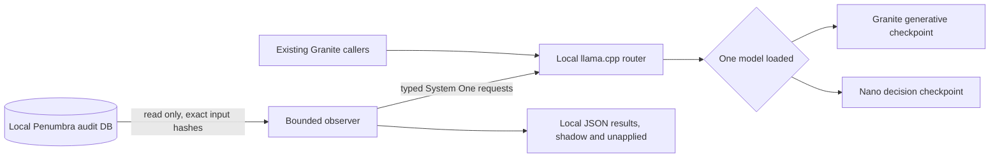

# Guarded System One validation run

Date: 2026-11-12. This run follows the [OS-access recovery](system-one-judge-memory-placement.md) and keeps native judge authority disabled. Production source, service configuration and the existing hosted Jev mode are unchanged. Observation and replay do not restart inference services. The later authorized Granite pause for CI is recorded below.

## Live observation attempt

The first observer followed only new `dream.p1.promotion` audit rows, requiring exact body SHA matches to the current T1 excerpt. A 60-second baseline preceded a planned 900-second observation window. Admission required 5.5 GiB free+inactive memory; reserve abort was 2 GiB, swap growth/outs bound 256 MiB, and health abort two consecutive failures. The daemon's local-shadow flag stayed off.

The observer stopped after 659.3 seconds with `stale_or_failed_guard`. It discovered zero new eligible inputs and sent zero candidate requests. All 748 resource samples had HTTP200 and zero swap growth. These are control-plane observations with no candidate exposure; they are not candidate latency, accuracy or reliability results. No synthetic work or historical backfill was inserted into this attempt.

The outer supervisor incorrectly retained `aborted=false` because the observer caught its error and exited0. The explicit [corrected interpretation](results/system-one-judges-2026-11-12-live-shadow/analysis.json) marks the attempt **interrupted and unexercised**, preserving both original records. The first supervisor combined slow multi-command resource/GPU sampling with critical admission freshness; exact per-command stall timing was not recorded. It does not establish that Nano caused a failure: Nano never ran.

A separate critical sensor and explicit observer-exit classification now fail closed. Thirteen regression tests cover stale/missing measurements, memory reservation/admission boundaries, health/swap bounds, zero exposure, partial runs and the error-with-exit 0 case. Tests initially failed because the guard helper did not exist, then all 13 passed.

The queue snapshot counted 71,367 T1 rollups, 10,733 unprocessed/unfiltered, 685 retry-exhausted and 286 unusable excerpts across all projects. These counts overlap and are not an eligible workload denominator. The broad due count omits claim/filter/queued-action policy. Judge-health timestamps remained at 11:50:58 during the attempted window. No production retry, filter, quorum or ingestion policy was reset to manufacture coverage. A live production shadow gate remains unexercised.

## Controlled historical replay

The revised run reuses `loadShadowInputs`, `observeInputs`, the strict local client and the existing resource sampler. It selects 20 hash-matched historical inputs, runs one request at a time with at least 30 seconds between admissions, and uses the same Nano Q8/2k profile. Critical admission snapshots run independently from GPU/RSS sampling; this avoids accepting stale critical measurements when slow diagnostics delay a resource sample.

This is a historical operational replay, including reused development cases. It supplies no independent labels, contemporary incumbent calls, F1/Brier/calibration evidence or downstream utility. Partial/unavailable recorded incumbent ballots cannot be treated as negative quorum decisions. The deliberate request spacing is not a throughput-capacity measurement.

A read-only aggregate queue query overlapped approximately 12:20:30–12:20:35 and took 4.24 seconds. Ordinary host activity is uncontrolled. No build, typed lint or full CI from this task overlaps inference. Service/authority configuration hashes are checked before and after the experiment. This is sampled per-request admission, not a kernel memory reservation or proof of indefinite residency. One-Hz sampling can miss peaks; GPU counters include other services and are not additive to RSS.

The 900-second admission window ended with **18/20 inputs attempted, 17 valid responses, one 5-second timeout and two unattempted inputs**. The result is **partial_runtime_replay**, not a full 20-case pass. Memory admission delayed work; limits were not relaxed to fill the denominator. All 18 recorded rows remain `mode=shadow, applied=false`; no candidate chose promotion. No model threshold or production authority changed.

| Measurement | Result |
| --- | --- |
| Successful-request p50 / p95 |559 /1570 ms |
| Timeout / malformed response |1 /0 |
| Mixed router/child sampled RSS median / peak |2.63 /4.20 GiB |
| Resource samples during replay |892;99.98% sampled-span coverage |
| Critical samples over whole run |960 |
| Minimum free+inactive memory |3.53 GiB |
| Swap growth / swap-outs |0 /0 |
| Full sampler HTTP probes, 2-second timeout |0 failures; p95 5.94 ms |
| Critical HTTP probes, 1-second timeout |1 timeout; two-failure abort not reached |

Resource summaries include prefix/suffix gaps. Mixed runtime RSS includes production Granite activity; it cannot be attributed to Nano alone. Per-model attribution was unavailable from retained process metadata, so no model-specific peak is invented. Boundary-straddling multi-command samples are excluded from phase summaries. Slow/resource and critical health series have different sampling times and deadlines and must not be merged into one failure rate. The one critical probe failure did not overlap a recorded candidate request interval; this is not causal proof. The candidate timeout occurred at 12:32:51 for 5003 ms, well before the trial deadline, so it is a real deadline failure rather than a window-censored request. Its cause was not isolated.

Of 17 answered cases, 11 had sufficient recorded historical ballots for a quorum comparison; two disagreed. Exact hashes for both disagreements match independently AI-reviewed negative labels in the earlier frozen development corpus, consistent with Nano's negative decisions. These are reused cases, not two additional independent tests or proof of current-pool superiority. Unanswered/partial historical ballots are not counted as NO decisions. Original review rationales remain private.

The candidate was explicitly unloaded after the window. The supervisor confirmed unchanged service/authority configuration and stopped its sampler. The [analysis](results/system-one-judges-2026-11-12-guarded-replay/analysis.json), [resource summaries](results/system-one-judges-2026-11-12-guarded-replay/replay-resources.json), [critical-probe overlap check](results/system-one-judges-2026-11-12-guarded-replay/health-probe-overlap.json) and [existing-review lookup](results/system-one-judges-2026-11-12-guarded-replay/disagreement-review-availability.json) preserve evidence. A completed, contemporary production shadow gate remains open.

## Timeout diagnostic regression

The real timeout exposed a diagnostic race: the local seat waited for the candidate, then began racing incumbent ballots against a deadline that had already fired. Even an already available incumbent could therefore be recorded as null. Authority was unaffected, but disagreement/error analysis lost evidence.

A new regression first failed on null incumbent votes, then passed after starting the bounded incumbent wait alongside candidate evaluation. The shared deadline and candidate latency semantics stay unchanged. Forty-seven focused adapter, runtime, composition and veto-isolation tests pass. The old timeout record is not rewritten. This source fix is prepared in the branch; production stays on its existing source with local shadow off. Full `bun run check:ci` passed all 7 blocking gates, 0 failures and 4 host/advisory skips on commit `5b0aa54b71a1152af50370bc93822293e3df9d22`. Its 15 reports contain 16,677 passing test executions, including repeated coverage. See the [CI attestation](results/system-one-judges-2026-11-12-guarded-replay/ci-validation.json). The existing heavy-job lock was held; Granite was paused while idle under user authorization and then restored with identical configuration. Actual configured T2-factory inference passed after restoration. Other inference services were untouched. The [final runtime observation](results/system-one-judges-2026-11-12-guarded-replay/final-runtime-status.json) confirms supervised services, Nano unloaded and Granite sleeping. No source fix was deployed to the daemon and local shadow remains off.

## Additional workload audit

Tracing `T2Promotion` found that a nonempty scrubbed `payload_summary` is preferred to raw payload text. The writer's default 20,000-character limit is applied before the worker's 80,000-character chunker; longer transcripts become head 8000 plus a truncation marker plus tail 8000. The chunker cannot recover omitted middle evidence. A valid empty memory array increments the empty-extraction health streak and marks the rollup processed. Malformed or truncated output follows a different failure path.

The [source audit](results/system-one-judges-2026-11-12-live-shadow/extraction-input-audit.json) corrects the workload inventory; no production input contract was changed. This is an input-loss risk, not proof of the cause of Granite's synthetic durable-positive failures. Input selection and generative extraction semantics need independent validation alongside bounded judge quality.
