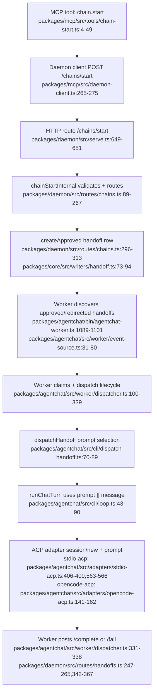

## Pipeline as-it-is-today

Current long-lived gap:
- Long-lived reactor exists but is not boot-wired in daemon serve/start flow (`packages/daemon/src/reactors/long-lived-reactor.ts` exists; no `createLongLivedReactor(...)` usage in `packages/daemon/src/serve.ts`).
- Tick substrate exists (`stampPrompt`, `createActionGate`, `handleTickTeardown`) but is not connected to chain dispatch path.
- MCP self-tool helpers exist but are not registered in MCP tool registry (`packages/mcp/src/tools/long-lived-self-*.ts` vs `packages/mcp/src/tools/registry.ts:97-639`).

## Insertion points

### 1) Dispatch marker + payload threading
- Touchpoints:
  - `packages/core/src/schemas/chain.ts:5-20`
  - `packages/daemon/src/routes/chains.ts:269-313`
  - `packages/core/src/db/schema.ts:94-118,507-524`
  - `packages/core/src/writers/handoff.ts:73-94`
  - `packages/core/src/schemas/handoff.ts:17-48`

Design:
- Extend chain-start input with explicit long-lived metadata for internal reactor spawns (at minimum `dispatch_kind`, plus `long_lived_agent_id` and `long_lived_tick_id`).
- Persist the same metadata on the handoff row so worker and completion routes can detect long-lived ticks without relying on in-memory state.
- Keep `from_agent='user'` semantics untouched for existing flows; long-lived behavior is driven by explicit marker fields, not by overloading `from_agent`.

### 2) Long-lived reactor boot + spawn path
- Touchpoints:
  - `packages/daemon/src/serve.ts` (startup wiring around orchestration setup at `:740-878`)
  - `packages/daemon/src/reactors/long-lived-reactor.ts:53-166`
  - `packages/daemon/src/routes/reload-config.ts:45-108`

Design:
- Instantiate `createLongLivedReactor(...)` during daemon boot and call `reload()` once after config load, then call `reload()` again on `/agentchat/reload` success.
- Provide reactor `spawn` that calls `chainStartInternal(...)` with a payload tagged `dispatch_kind='long_lived_tick'`, `use_worktree=false`, and `max_hops=1`.
- Include tick identity (`long_lived_tick_id`, `long_lived_agent_id`) in that payload so the handoff row becomes the durable correlation record.

### 3) Prompt composition seam for ticks
- Touchpoints:
  - Prompt seam today: `packages/agentchat/src/cli/dispatch-handoff.ts:70-76`
  - Prompt fallback: `packages/agentchat/src/cli/loop.ts:43`
  - Long-lived stamper: `packages/daemon/src/long-lived/prompt-stamper.ts:19-63`

Design:
- Stamp long-lived prompt before the worker sees the handoff: during chain-start creation in daemon, replace `input.message` with `stampPrompt(...)` output when `dispatch_kind='long_lived_tick'`.
- Rationale: current worker logic for first hop (`from_agent==='user'`) passes handoff message verbatim into adapter prompt path; stamping earlier reuses existing worker behavior and avoids worker DB lookups for long-lived state.
- Keep worker-side prompt composition unchanged for non-long-lived dispatches.

### 4) Dynamic tool registry + action gate
- Touchpoints:
  - ACP session stamping: `packages/agentchat/src/adapters/stdio-acp.ts:379-409`
  - Opencode MCP config stamping: `packages/agentchat/src/adapters/opencode-mcp-config.ts:43-75`
  - Permission gate (insufficient for 3-tier semantics): `packages/agentchat/src/worker/permission-callback.ts:37-61`
  - Action gate substrate: `packages/daemon/src/long-lived/action-gate.ts:77-194`

Design:
- Add per-dispatch MCP override envelope in worker dispatch path for long-lived ticks: clone agent MCP server config and inject env markers (`PENUMBRA_HANDOFF_ID`, `PENUMBRA_RUNNING_AGENT_ID`, `PENUMBRA_LONG_LIVED_TICK_ID`, optional allowlist hash/version).
- Enforce 3-tier policy at MCP tool execution boundary (daemon/MCP side), not only in worker permission callback. Worker callback can only approve/reject; it cannot produce queued-for-approval tool results or snapshot/cooldown behavior.
- Tool list shown to ACP session should reflect effective allowlist, but authoritative enforcement must still happen server-side through `createActionGate(...)`.

### 5) MCP `running_agent_id` context propagation
- Touchpoints:
  - Existing env propagation pattern: `packages/agentchat/src/adapters/stdio-acp.ts:392-404`
  - Self-tool expectations: `packages/mcp/src/tools/long-lived-self-state-get.ts:4-18`, `...state-set.ts:11-31`, `...pending-actions.ts:3-13`
  - MCP server/tool registration: `packages/mcp/src/server.ts:5-14`, `packages/mcp/src/tools/registry.ts:97-639`

Design:
- Register long-lived self-tools in MCP registry and resolve `running_agent_id` from dispatch-scoped env injected by adapter session config.
- Implement handler wrappers that build context `{ running_agent_id: process.env.PENUMBRA_RUNNING_AGENT_ID }` and pass into existing helper functions.
- This avoids protocol changes to MCP transport and matches current per-dispatch env injection model already used for `PENUMBRA_HANDOFF_ID`.

### 6) Teardown hook on chain completion
- Touchpoints:
  - Completion routes: `packages/daemon/src/routes/handoffs.ts:247-265,342-367`
  - Teardown substrate: `packages/daemon/src/long-lived/teardown.ts:17-77`

Design:
- Invoke `handleTickTeardown(...)` in daemon terminal transitions for marked long-lived handoffs:
  - `/handoffs/:id/complete` -> outcome `success`
  - `/handoffs/:id/fail` and cancel-to-fail path -> outcome `failed` (or `bound_exceeded` if reason classifier matches budget termination)
- Resolve `tick_id` and `agent_id` from persisted handoff marker fields; resolve cost from available ledger snapshot at completion time (nullable if unavailable).
- This keeps teardown authoritative in daemon DB path and avoids requiring worker-side DB access.

## Open questions resolved

1. Marker for "this dispatch is a long-lived tick"
- Recommendation: both payload and row.
- Add fields to chain-start payload and persist on handoff row (`dispatch_kind`, `long_lived_agent_id`, `long_lived_tick_id`).
- Why: payload is needed to shape dispatch behavior at creation time; row persistence is needed later by worker + completion routes + audits.

2. Prompt composition seam
- Recommendation: stamp in daemon chain-start creation path for marked ticks.
- Exact current seam proving behavior: `dispatchHandoff()` chooses chain-start prompt path at `packages/agentchat/src/cli/dispatch-handoff.ts:70-76`, then `runChatTurn()` uses `input.prompt ?? input.userMessage` at `packages/agentchat/src/cli/loop.ts:43`.
- Therefore stamped message should be written before worker dispatch, not computed deep in adapters.

3. Dynamic tool-registry stamping strategy
- Recommendation: option (a) with server-side enforcement.
- Compute effective per-tick allowlist before `chain_start`; pass through as per-dispatch override/env; worker applies one-off adapter MCP config override.
- Do not rely on option (b) alone: worker permission callback cannot implement snapshot/cooldown/queued-approval semantics required by `createActionGate(...)`.

4. MCP context injection for `running_agent_id`
- Recommendation: env-backed context bag per dispatch, no protocol change.
- Inject `PENUMBRA_RUNNING_AGENT_ID` alongside `PENUMBRA_HANDOFF_ID` in adapter MCP server config; self-tool wrappers in MCP registry resolve env -> `ctx.running_agent_id`.

5. Teardown invocation point
- Recommendation: daemon handoff terminal routes (`/complete` and `/fail`) keyed by persisted long-lived marker.
- This is the most reliable point where terminal outcome is authoritative and DB writes are local.

## Implementation phases

### Phase A: Marker + spawn plumbing (no gating yet)
- Add chain-start + handoff schema/DB fields for long-lived markers.
- Boot reactor in daemon serve startup and reload path.
- Reactor spawn uses `/chains/start` with `dispatch_kind='long_lived_tick'`, `use_worktree=false`, `max_hops=1`, and tick/agent IDs.
- Tests:
  - Extend chain-start route tests to verify marker persistence.
  - Extend long-lived reactor tests to verify spawn payload tagging.

### Phase B: Prompt stamping + tick identity continuity
- In `chainStartInternal`, when `dispatch_kind='long_lived_tick'`, load long-lived agent row, call `stampPrompt(...)`, and persist stamped message in handoff.
- Ensure long-lived tick fields are present in created handoff for downstream completion correlation.
- Tests:
  - Integration test that created handoff message contains stamped sections (`Tick context`, `Required protocol`).

### Phase C: Per-dispatch MCP override + self-tool registration
- Register `long_lived_self_*` MCP tools.
- Add per-dispatch MCP env injection for running/tick identity in stdio-acp and opencode-acp paths.
- Apply effective allowlist override for long-lived dispatch only (no global config mutation).
- Tests:
  - MCP self-tool registry visibility and context-required behavior.
  - Dispatch-level env injection verified for penumbra MCP server config.

### Phase D: Action-gate enforcement + teardown
- Wire action gate at MCP tool execution boundary for marked long-lived dispatches.
- Hook `handleTickTeardown(...)` in daemon completion/failure transitions using persisted marker fields.
- Tests:
  - End-to-end long-lived tick: spawn -> self-state set -> completion updates `long_lived_ticks` + `long_lived_agents`.
  - Failure path increments `consecutive_failures`, trips breaker at threshold.

## Risks / open items

- MCP self-tools are currently unregistered; naming alignment is unresolved (`penumbra:long_lived_self_*` allowlist strings vs actual MCP tool IDs in registry).
- `dispatch_kind` is referenced in spec/plan but absent in live code (`rg dispatch_kind` shows no runtime hits); this is schema/API drift and must be introduced explicitly.
- Long-lived reactor is implemented but not boot-wired in daemon startup, so cron/event ticks are inert until serve wiring lands.
- Cost attribution timing at teardown can be late relative to handoff completion; implementation should tolerate `cost_cents=null` and optionally backfill.
- Existing worker permission gate remains necessary for non-long-lived trust flows; long-lived action-gate wiring must be dispatch-scoped to avoid behavior regressions.
