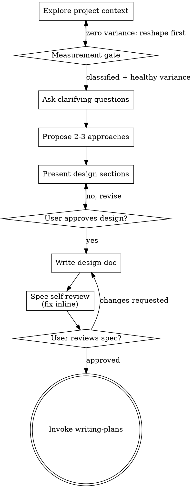

# Brainstorming Ideas Into Designs

Help turn ideas into fully formed designs and specs through natural collaborative dialogue.

Start by understanding the current project context, then ask questions one at a time to refine the idea. Once you understand what you're building, present the design and get user approval.

<HARD-GATE>
Do NOT invoke any implementation skill, write any code, scaffold any project, or take any implementation action until you have presented a design and the user has approved it. This applies to EVERY project regardless of perceived simplicity.
</HARD-GATE>

## Anti-Pattern: "This Is Too Simple To Need A Design"

Every project goes through this process. A todo list, a single-function utility, a config change — all of them. "Simple" projects are where unexamined assumptions cause the most wasted work. The design can be short (a few sentences for truly simple projects), but you MUST present it and get approval.

## Checklist (9 items, with HARD GATE at Step 1.5)

You MUST create a task for each of these items and complete them in order:

1. **Explore project context** — check files, docs, recent commits

### Step 1.5: Measurement gate

Before proposing approaches, verbalize one of:

A) **Not a measurement task.** This work is building / refactoring /
   fixing without a metric-comparison or eval question. State this
   explicitly, then proceed to clarifying questions.

B) **This work involves measuring, comparing, or evaluating something
   via a metric.** Before drafting any approach:

   1. Identify the primary metric. Be specific — `table.column`,
      computed expression, or operational definition. Vague targets
      ("quality", "performance") are not yet metrics.

   2. Run a variance / distribution query on the existing data source.
      Quote the **aggregate** result (counts, ratios, unique-value count,
      min/max bucket sizes). Do not paste raw rows or raw column values;
      those can include PII, secrets, or other sensitive data that should
      not appear in transcripts or memory. If the metric itself is sensitive
      or could leak values, report only cardinality and bucketing.
      Examples:
      - SQL: `SELECT <metric>, COUNT(*) FROM <source> GROUP BY <metric>` where `<metric>` and `<source>` are statically-known identifiers (never interpolate user input as SQL identifiers). If `<metric>` contains sensitive values, use `SELECT COUNT(DISTINCT <metric>), MIN(cnt), MAX(cnt), AVG(cnt) FROM (SELECT <metric>, COUNT(*) AS cnt FROM <source> GROUP BY <metric>) t` and report only the aggregates.
      - Code metric: summarize aggregate bucket sizes, unique-value counts,
        and distribution summaries. Do not include raw values.
      - External system: pull recent N data points and report only
        frequency/count buckets or other aggregate-level distributions.

   3. Decide based on the result:
      - **Zero variance** (all rows equal value): the eval is
        unmeasurable as posed. STOP. Reshape the question before
        drafting any approach.
      - **Heavily skewed variance**: one value dominates the distribution
        (for example, the modal class accounts for the vast majority of
        rows). Flag the imbalance; consider whether the imbalance itself
        is the actual question, rather than the metric you proposed
        measuring.
      - **Healthy variance**: proceed to clarifying questions.

Why this gate exists: an eval-plan drafted earlier in penumbra's history
proposed measuring lane outcomes via `gate_outcome=passed`, which had
zero variance (48 of 48 closed lanes were passed). A 30-second SQL
query before drafting would have killed the plan. The cost of this
gate is one classification line in the brainstorm transcript per
session; the savings is avoiding unmeasurable evals.

2. **Ask clarifying questions** — one at a time, understand purpose/constraints/success criteria
3. **Propose 2-3 approaches** — with trade-offs and your recommendation
4. **Present design** — in sections scaled to their complexity, get user approval after each section
5. **Write design doc** — save to `docs/superpowers/specs/YYYY-MM-DD-<topic>-design.md` and commit
6. **Spec self-review** — quick inline check for placeholders, contradictions, ambiguity, scope (see below)
7. **User reviews written spec** — ask user to review the spec file before proceeding
8. **Transition to implementation** — invoke the penumbra `writing-plans` skill to create an implementation plan

## Process Flow

**Note on representation:** The 9-item checklist above is the contract. The prose sections under "The Process" and the digraph below are illustrative and non-normative. If they disagree, the checklist wins.

**The terminal state is invoking penumbra writing-plans.** Do NOT invoke frontend-design, mcp-builder, or any other implementation skill. The ONLY skill you invoke after brainstorming is the penumbra `writing-plans`.

## The Process

**Understanding the idea:**

- Check out the current project state first (files, docs, recent commits)
- Before asking detailed questions, assess scope: if the request describes multiple independent subsystems (e.g., "build a platform with chat, file storage, billing, and analytics"), flag this immediately. Don't spend questions refining details of a project that needs to be decomposed first.
- If the project is too large for a single spec, help the user decompose into sub-projects: what are the independent pieces, how do they relate, what order should they be built? Then brainstorm the first sub-project through the normal design flow. Each sub-project gets its own spec → plan → implementation cycle.
- For appropriately-scoped projects, ask questions one at a time to refine the idea
- Prefer multiple choice questions when possible, but open-ended is fine too
- Only one question per message - if a topic needs more exploration, break it into multiple questions
- Focus on understanding: purpose, constraints, success criteria

**Exploring approaches:**

- Propose 2-3 different approaches with trade-offs
- Present options conversationally with your recommendation and reasoning
- Lead with your recommended option and explain why

**Presenting the design:**

- Once you believe you understand what you're building, present the design
- Scale each section to its complexity: a few sentences if straightforward, up to 200-300 words if nuanced
- Ask after each section whether it looks right so far
- Cover: architecture, components, data flow, error handling, testing
- Be ready to go back and clarify if something doesn't make sense

**Design for isolation and clarity:**

- Break the system into smaller units that each have one clear purpose, communicate through well-defined interfaces, and can be understood and tested independently
- For each unit, you should be able to answer: what does it do, how do you use it, and what does it depend on?
- Can someone understand what a unit does without reading its internals? Can you change the internals without breaking consumers? If not, the boundaries need work.
- Smaller, well-bounded units are also easier for you to work with - you reason better about code you can hold in context at once, and your edits are more reliable when files are focused. When a file grows large, that's often a signal that it's doing too much.

**Working in existing codebases:**

- Explore the current structure before proposing changes. Follow existing patterns.
- Where existing code has problems that affect the work (e.g., a file that's grown too large, unclear boundaries, tangled responsibilities), include targeted improvements as part of the design - the way a good developer improves code they're working in.
- Don't propose unrelated refactoring. Stay focused on what serves the current goal.

## After the Design

**Documentation:**

- Write the validated design (spec) to `docs/superpowers/specs/YYYY-MM-DD-<topic>-design.md`
  - (User preferences for spec location override this default)
- Use elements-of-style:writing-clearly-and-concisely skill if available
- Commit the design document to git

**Spec Self-Review:**
After writing the spec document, look at it with fresh eyes:

1. **Placeholder scan:** Any "TBD", "TODO", incomplete sections, or vague requirements? Fix them.
2. **Internal consistency:** Do any sections contradict each other? Does the architecture match the feature descriptions?
3. **Scope check:** Is this focused enough for a single implementation plan, or does it need decomposition?
4. **Ambiguity check:** Could any requirement be interpreted two different ways? If so, pick one and make it explicit.

Fix any issues inline. No need to re-review — just fix and move on.

A `spec-document-reviewer-prompt.md` template is available in this skill directory for dispatching a spec reviewer subagent when deeper review is warranted.

**User Review Gate:**
After the spec review loop passes, ask the user to review the written spec before proceeding:

> "Spec written and committed to `<path>`. Please review it and let me know if you want to make any changes before we start writing out the implementation plan."

Wait for the user's response. If they request changes, make them and re-run the spec review loop. Only proceed once the user approves.

**Implementation:**

- Invoke the penumbra `writing-plans` skill (via `/write-plan` or by name) to create a detailed implementation plan
- Do NOT invoke any other skill. `writing-plans` is the next step.

## Key Principles

- **One question at a time** - Don't overwhelm with multiple questions
- **Multiple choice preferred** - Easier to answer than open-ended when possible
- **YAGNI ruthlessly** - Remove unnecessary features from all designs
- **Explore alternatives** - Always propose 2-3 approaches before settling
- **Incremental validation** - Present design, get approval before moving on
- **Be flexible** - Go back and clarify when something doesn't make sense

## Penumbra integration

**Slash trigger:** `/brainstorm` invokes the playbook at
`plugin/playbooks/brainstorm/playbook.md`, which pre-loads
`docs/superpowers/specs/*.md` globs and recent brainstorm-tagged t2
memory before the process begins. You do not need to run those steps
manually when invoked via the slash.

**`writing-plans` reference:** Every mention of `writing-plans` in this
skill (Step 8, the terminal-state note, and the Implementation subsection)
refers to the local penumbra version at `plugin/skills/writing-plans/`,
not `penumbra:writing-plans`. The `superpowers:` namespace is being
retired in favour of the penumbra fork.

**Visual companion removed:** Penumbra deliberately omits the
browser-mockup companion step from this skill to keep brainstorming
terminal-first. The upstream Visual Companion section and the
`visual-questions?` decision node in the upstream process digraph are
not present here.

## Filing task drafts (stumble-filing)

For brainstorming work, treat a stumble as any follow-up item, gap, bug, or design idea worth doing later that blocks the current focus.
Before filing, search `memory_search` for a similar pending task or existing draft and skip filing when the same work is already tracked.
If the stumble is still new, file it immediately with `mcp__penumbra__memory_observe` so the idea survives the current session.
Use `event_type: 'task_draft'` and include a fresh UUID v4 `draft_id`, a one-paragraph `prompt`, at least one `affects_projects` entry, and an `evidence` object with whatever `conv_ids`, `commits`, `files`, and `session_id` you have.
Set `auto_ok: false` by default; only set it to `true` for trivially safe items that do not need review.
Always set `filed_by_agent` to your agent name, `filed_via: 'skill_inline'`, and `parent_draft_id: null`.
Example MCP call shape:
`mcp__penumbra__memory_observe({ event_type: 'task_draft', payload_json: { draft_id: '01234567-89ab-cdef-0123-456789abcdef', prompt: '...', affects_projects: ['penumbra'], evidence: { conv_ids: [], commits: [], files: [], session_id: '...' }, auto_ok: false, filed_by_agent: 'claude', filed_via: 'skill_inline', parent_draft_id: null } })`
Keep the filing short and concrete, then continue the design conversation.
